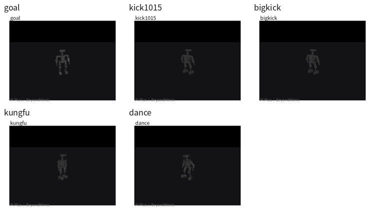
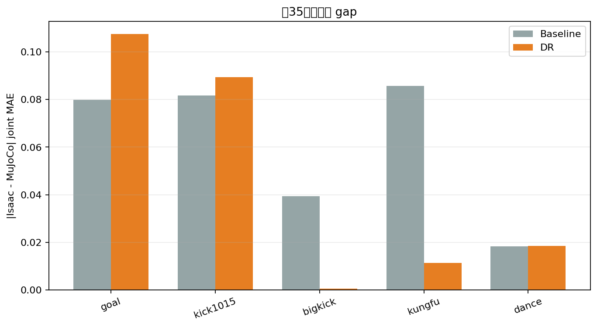
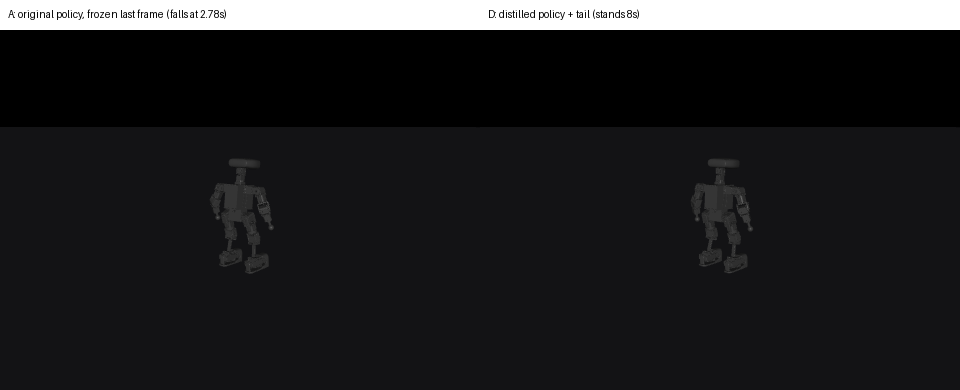

# Pi Plus Humanoid — Motion Imitation & Cross-Engine (Isaac Sim ⇄ MuJoCo) Validation

**BeyondMimic-style RL motion imitation for a 22-DoF humanoid, plus a reproducible cross-engine
sim-to-sim validation and root-cause analysis pipeline.**

[中文说明](README.zh-CN.md)



*Five learned motion policies (goal / kick1015 / bigkick / kungfu / dance) replaying in MuJoCo from
the same ONNX policy exported out of Isaac Lab.*

---

## Scope and status (read this first)

| | |
|---|---|
| **Robot** | HighTorque Pi Plus humanoid, 22 actuated joints, ~11 kg |
| **Simulators** | Isaac Sim 5.0.0 + Isaac Lab 2.2.0 (training) · MuJoCo 3.14 (independent check) |
| **RL stack** | PPO via `rsl_rl` 2.3.1, 4096 parallel envs, 50 Hz control |
| **What is done** | 5 policies trained to convergence → ONNX export → cross-engine replay → staged root-cause analysis (R1–R5) → motion tail repair + dual-engine acceptance |
| **What is *not* done** | ❌ No real-robot deployment. ❌ Residual cross-engine gap is *localised*, not eliminated. |
| **Evidence style** | Every claim below is backed by a JSON/script artifact in this repo or is explicitly labelled as bounded evidence |

This repository is a **curated excerpt** of my own diagnostics, reports and tooling — it is not a
fork of the upstream training framework (see [Attribution](#attribution)).

---

## Results at a glance

### 1. Five motion policies, all converged

| Motion | Iterations | Final reward | Episode length (max 500) |
|---|---:|---:|---:|
| `goal` | 10 000 | 41.77 | ~496 |
| `kick1015` | 10 000 | 46.93 | ~499 |
| `bigkick` | 10 000 | ~39 | ~490 |
| `kungfu` | 10 000 | 39.8 | 482–496 |
| `dance` | 10 000 | ~39 | ~488 |

No NaN, `error_body_pos` converged to 0.026–0.033 m, episode length within 1 % of the 10 s horizon.

### 2. A cross-engine `q` gap of 0.035 rad — decomposed, not guessed



| Round | Hypothesis | Method | Result |
|---|---|---|---|
| **R1** | Controller implementation differs | MuJoCo explicit PD vs `position` actuator | `1.86e-12 rad` — negligible |
| **R2** | Collision geometry differs | Compiled mesh vs STL vs convex hull; AABB + closest point | `1.32e-9 m` / `4.02e-9 m` — negligible |
| **R3** | Contact timing differs | Foot contact sensor (Isaac) vs foot proxy (MuJoCo) | **Differs** on several motions |
| **R4** | Contact force differs | Normal-force peaks at matched timestamps | **Differs, motion-dependent** (kick1015 @3 s: Isaac ≈ 1112 N vs MuJoCo ≈ 387 N) |
| **R5** | Some contact-parameter set fixes both | 108-combination sweep of `solref`/`solimp`/`condim`/friction/margin × 2 motions | **No universal optimum** — per-motion winners disagree |

**Conclusion:** general-purpose parameter tuning is saturated. The residual gap sits in the
**foot-contact solving mechanism**, not in parameters a user can tune.

### 3. A silent evaluation-protocol bug that looked like a simulator bug

`bigkick`, `goal` and `kick1015` fell over in MuJoCo after 2–6 s. The initial hypothesis — "PhysX and
MuJoCo contact solvers are fundamentally different" — was **wrong**.

- Per-control-step analysis: all three track the reference well (MAE 0.06–0.13 rad) and fall
  **0.7–1.0 s *after* the reference segment ends**.
- The training env resamples a new motion the instant the reference ends, so the policy **never
  learned to hold a frozen final frame** — and that is exactly what the evaluator asked of it.
- Re-tested in Isaac under the same protocol: Isaac falls too (bigkick 3.30 s vs MuJoCo 2.78 s;
  goal 6.08 vs 5.56; kick1015 3.02 vs 2.64). The "Isaac is stable for 9.8 s" claim came from a 12 s
  motion that never reached its end, in an env that auto-reset.

> **Evaluation protocol ≠ training protocol.** That was the root cause.

### 4. Motion tail repair — three-step recipe, dual-engine acceptance

Fix: generate a 1.5 s quintic transition to the default stance + 1.2 s hold, then staged retraining
(T1 tail 2000 it · T2 original-segment weight p=0.5 · T3 p=0.7 · T4 **distillation from the original
policy**, λ=0.1) so stability is gained **without** losing imitation fidelity.



*Left: original policy, falls at 2.78 s. Right: repaired policy, holds 8 s.*

Acceptance = 8 s no-fall · ≥2 s hold after the reference ends · **0 state resets** · original-segment
MAE ≤ 1.10 × baseline.

| Motion | Engine | Original-segment MAE | Threshold | Post-segment hold | Resets |
|---|---|---:|---:|---:|---:|
| `bigkick` | MuJoCo | 0.0607 | 0.0736 | 3.54 s | 0 |
| `bigkick` | Isaac | 0.0528 | 0.0619 | 3.54 s | 0 |
| `kick1015` | MuJoCo | 0.0658 | 0.0665 | 3.54 s | 0 |
| `kick1015` | Isaac | 0.0530 | 0.0534 | 3.54 s | 0 |

Naive fine-tuning *also* stabilises the robot — but costs 14.6 % (MuJoCo) / 21.8 % (Isaac) MAE, and
the degradation is concentrated entirely in the arms. Distillation is what buys stability without
that trade. Diagnostics: [`assets/round4_analysis.png`](assets/round4_analysis.png).

---

## Four bugs that made the two simulators disagree for *non-physical* reasons

These are the parts I would actually defend in an interview, because each one silently invalidates
every cross-engine number until it is fixed.

**1. PhysX articulation joint order is breadth-first, not URDF declaration order.**
URDF/MJCF list joints grouped by limb (left leg → right leg → left arm → right arm); PhysX exposes
them in BFS traversal order. Disambiguated by forward kinematics against reference body poses:

```
assume CSV order  → mean FK error 0.0914 m
assume BFS order  → mean FK error 0.0002 m   (450× smaller) ✅
```
Confirmed independently by dumping articulation joint names from Isaac. Nothing in the training
pipeline surfaces this — it only breaks the moment you cross engines.

**2. Body-index mapping between the motion `.npz` (23 bodies) and the tracked subset (13 bodies).**
Recovered by matching against the ONNX policy's embedded reference data — residual `0.000000`.

**3. Wrong `base_link` inertia in the URDF → total mass 18.755 kg instead of 11.0002 kg.**
A 70 % mass error that is invisible during training (the policy adapts to whatever mass it is given)
and catastrophic for cross-engine comparison. Corrected URDF (11.0002 kg) vs MJCF (11.18 kg) agree
to 1.6 %.

**4. Torque limits were configured but never enabled.**
Auto-generated MJCF had every actuator force-range flag `false`; the old script edited the numbers
without flipping the switch. Measured post-segment torque reached **45 N·m against a 30 N·m
setpoint**. Fixed to real limits (legs 30 N·m / arms 20 N·m).

Full write-up: [`docs/04_pitfalls.md`](docs/04_pitfalls.md).

---

## Pipeline

```
human motion (BVH / SMPL-X)
        │  GMR retargeting
        ▼
   CSV joint angles ──► NPZ (joint pos/vel + body poses, via Isaac FK)
        │
        ▼
   PPO training (rsl_rl, 4096 envs, Isaac Lab 2.2)
        │
        ▼
   .pt checkpoint ──► ONNX (+ metadata: joint/body names, gains, BFS order)
        │
        ├──► MuJoCo replay ──┐
        │                    ├──► cross-engine diff (q gap, contact timing, contact force)
        └──► Isaac replay ───┘
                             │
                             ▼
                    R1–R5 root-cause analysis
                             │
                             ▼
              acceptance gate (dual engine, zero reset)
```

Deliverables of this stage: a validated ONNX policy per motion, a matched-state replay harness for
both engines, and a quantified, attributed gap.

---

## Repository layout

```
├── assets/          GIFs and figures used in this README
├── docs/            curated write-ups (pipeline, diagnosis, acceptance, pitfalls)
├── reports/         raw per-round experiment reports (the evidence trail)
├── scripts/         my diagnostic / analysis / export tooling
└── README.md
```

| Doc | Contents |
|---|---|
| [`docs/01_pipeline.md`](docs/01_pipeline.md) | training → export → replay, with the exact commands and config |
| [`docs/02_cross_engine_diagnosis.md`](docs/02_cross_engine_diagnosis.md) | R1–R5 in full, with indicators and evidence boundaries |
| [`docs/03_acceptance_protocol.md`](docs/03_acceptance_protocol.md) | the repair recipe and the dual-engine acceptance gate |
| [`docs/04_pitfalls.md`](docs/04_pitfalls.md) | the four silent-mismatch bugs, and how each was proved |
| [`scripts/README.md`](scripts/README.md) | index of every script and what question it answers |

---

## Reproduction notes

The scripts were written against a shared 4×RTX 4090 Linux box and read experiment artifacts from
absolute paths under `/data/gaoli/logs/...`. They are published as-run, i.e. **they document the
method, they are not a packaged CLI**; paths and motion files must be adapted. Each script carries a
docstring stating the question it answers and the evidence class it produces
(`[dynamics comparison]` vs `[trajectory replay]`), because several conclusions were only valid under
one of the two.

Environment: Ubuntu 22.04 · Isaac Sim 5.0.0 · Isaac Lab 2.2.0 · PyTorch 2.7.0 + CUDA 12.8 ·
MuJoCo 3.14 · ONNX Runtime 1.30 · Python 3.11.

A reproducible environment build (including the four Isaac Sim packaging traps: the 4-digit version
string, NVIDIA index as *primary* source, mandatory `[extscache,all]` extras, and the CMake 4
`cmake_minimum_required` break) is documented in [`docs/01_pipeline.md`](docs/01_pipeline.md).

---

## Attribution

- Training framework, robot description and retargeting pipeline: **BeyondMimic / Mini-Pi-Plus_BeyondMimic**
  by HighTorque Robotics — <https://github.com/HighTorque-Robotics/Mini-Pi-Plus_BeyondMimic>
  (upstream; not redistributed here).
- Everything in `scripts/`, `docs/`, `reports/` and the analyses in this README is my own work.
- The upstream repository ships no license file at the time of writing; this repo therefore contains
  **no upstream source code**, only my own tools and results.

## License

MIT for the contents of this repository (code and text authored by me).
Motion capture data and the robot model remain the property of their original providers.
