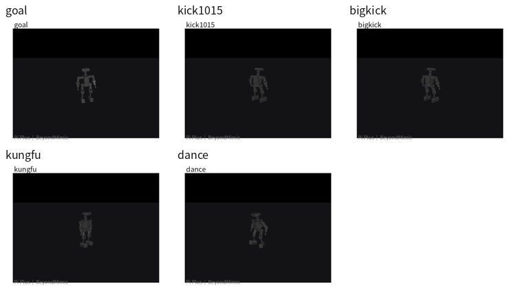
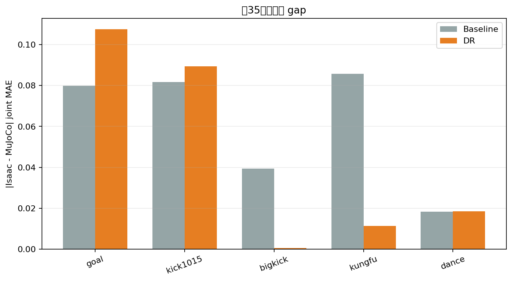
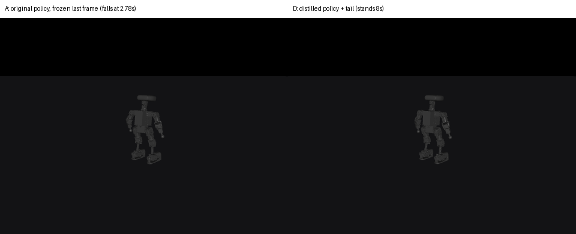

# Pi Plus 人形机器人 —— 动作模仿与跨引擎（Isaac Sim ⇄ MuJoCo）验证

**基于 BeyondMimic 框架的 22 自由度人形机器人强化学习动作模仿，以及一套可复算的
sim-to-sim 交叉验证与差异溯源流水线。**

[English](README.md)



*五个动作策略（goal / kick1015 / bigkick / kungfu / dance）从 Isaac Lab 导出的同一份 ONNX
策略在 MuJoCo 中回放。*

---

## 先看范围与状态

| | |
|---|---|
| **机器人** | 高擎 HighTorque Pi Plus 人形机器人，22 个驱动关节，约 11 kg |
| **仿真器** | Isaac Sim 5.0.0 + Isaac Lab 2.2.0（训练）· MuJoCo 3.14（独立校验） |
| **强化学习** | PPO（`rsl_rl` 2.3.1），4096 并行环境，50 Hz 控制频率 |
| **已完成** | 5 个动作训练收敛 → ONNX 导出 → 跨引擎回放 → R1–R5 分轮溯源 → 动作收尾修复 + 双引擎验收 |
| **未完成** | ❌ 尚未上真机；❌ 残余跨引擎差异只做到了**定位**，没有消除 |
| **证据风格** | 下面每个结论都对应本仓库中可复算的 JSON / 脚本；证据边界会显式标注 |

本仓库是我自己那部分**诊断脚本、实验报告与分析结论的精选归档**，不是上游训练框架的 fork
（见[致谢](#致谢)）。

---

## 结果速览

### 1. 五个动作策略全部收敛

| 动作 | 迭代轮数 | 最终 reward | episode 长度（上限 500） |
|---|---:|---:|---:|
| `goal` | 10 000 | 41.77 | ~496 |
| `kick1015` | 10 000 | 46.93 | ~499 |
| `bigkick` | 10 000 | ~39 | ~490 |
| `kungfu` | 10 000 | 39.8 | 482–496 |
| `dance` | 10 000 | ~39 | ~488 |

全程无 NaN，`error_body_pos` 收敛到 0.026–0.033 m，episode 长度距 10 s 上限差距在 1% 以内。

### 2. 0.035 rad 的跨引擎差异 —— 是被拆解的，不是猜的



| 轮次 | 假设 | 做法 | 结果 |
|---|---|---|---|
| **R1** | 控制器实现不同 | MuJoCo 显式 PD 对比 `position` actuator | `1.86e-12 rad`，可忽略 |
| **R2** | 碰撞几何不同 | 编译网格 / 原始 STL / 凸包，AABB 与最近点 | `1.32e-9 m` / `4.02e-9 m`，可忽略 |
| **R3** | 接触时序不同 | Isaac 足部接触传感器 vs MuJoCo 足部代理量 | **不同**（多个动作） |
| **R4** | 接触力不同 | 对齐时刻的法向力峰值比较 | **不同，且依动作而变**（kick1015 3 s：Isaac ≈ 1112 N vs MuJoCo ≈ 387 N） |
| **R5** | 存在一组通用接触参数 | `solref`/`solimp`/`condim`/摩擦/`margin` 共 108 组 × 2 动作 | **不存在通用最优**，单动作最优组合互相冲突 |

**结论**：通用调参这条路已经饱和。残余差异位于**脚底接触求解机制**，不在用户可调的参数上。

### 3. 一个伪装成"仿真器 bug"的评估协议 bug

`bigkick`、`goal`、`kick1015` 在 MuJoCo 里 2–6 秒倒地。最初的判断——"PhysX 与 MuJoCo 接触求解器
本质不同"——**是错的**。

- 逐控制步分析：三个动作在参考段内跟踪良好（MAE 0.06–0.13 rad），倒地全部发生在**参考段结束
  之后 0.7–1.0 s**。
- 训练环境在参考结束的瞬间就重采样新动作，策略**从未学过"冻结末帧保持"**——而这正是评估器
  要求它做的事。
- 用同一协议在 Isaac 里复测：Isaac 也倒（bigkick 3.30 s vs MuJoCo 2.78 s；goal 6.08 vs 5.56；
  kick1015 3.02 vs 2.64）。旧结论"Isaac 稳 9.8 s"来自一段 12 s、从未播到结尾的动作，且环境会
  自动复位。

> **评估协议 ≠ 训练协议**，这才是根因。

### 4. 动作收尾修复 —— 三步法，双引擎验收

做法：从原动作末帧生成 1.5 s 五次多项式过渡到默认站姿 + 1.2 s 保持，再用分阶段重训
（T1 尾段 2000 轮 · T2 原段加权 p=0.5 · T3 p=0.7 · T4 **从原策略蒸馏**，λ=0.1），在拿到稳定性的
同时**不牺牲动作保真度**。



*左：原策略，2.78 s 倒地。右：修复后，站满 8 s。*

验收口径 = 8 s 不倒地 · 参考结束后保持 ≥2 s · **状态复位 0 次** · 原段 MAE ≤ 基线 × 1.10。

| 动作 | 引擎 | 原段 MAE | 阈值 | 段后保持 | 复位次数 |
|---|---|---:|---:|---:|---:|
| `bigkick` | MuJoCo | 0.0607 | 0.0736 | 3.54 s | 0 |
| `bigkick` | Isaac | 0.0528 | 0.0619 | 3.54 s | 0 |
| `kick1015` | MuJoCo | 0.0658 | 0.0665 | 3.54 s | 0 |
| `kick1015` | Isaac | 0.0530 | 0.0534 | 3.54 s | 0 |

普通微调同样能让机器人站住，但代价是 MAE 退化 14.6%（MuJoCo）/ 21.8%（Isaac），且退化**全部
集中在手臂**。蒸馏才是在不付这笔代价的前提下换到稳定性。逐关节分解见
[`assets/round4_analysis.png`](assets/round4_analysis.png)。

---

## 四个让两个仿真器"因为非物理原因"对不上的 bug

这四个是我在面试里最愿意展开讲的，因为在修掉之前，任何跨引擎数字都是无效的。

**1. PhysX 的 articulation 关节顺序是广度优先（BFS），不是 URDF 声明顺序。**
URDF/MJCF 按肢体分组列出关节（左腿 → 右腿 → 左臂 → 右臂），PhysX 内部按 BFS 遍历顺序暴露。
用正运动学对齐参考身体位姿来判定：

```
假设 CSV 顺序  → 平均 FK 误差 0.0914 m
假设 BFS 顺序  → 平均 FK 误差 0.0002 m   （小 450 倍）✅
```
再用 Isaac 直接 dump 关节名独立确认。训练链路里完全看不出来，一跨引擎立刻炸。

**2. `.npz` 动作数据（23 个身体）与训练跟踪子集（13 个身体）的索引映射。**
通过 ONNX 策略内嵌的参考数据反解，残差 `0.000000`。

**3. URDF 里 `base_link` 惯性写错 → 总质量 18.755 kg，而正确值是 11.0002 kg。**
70% 的质量误差在训练中完全隐形（策略会适应任何给它的质量），但对跨引擎对比是灾难。
修正后 URDF（11.0002 kg）与 MJCF（11.18 kg）相差 1.6%。

**4. 力矩限幅配了但从未真正启用。**
自动生成的 MJCF 里所有 actuator 力限幅开关是 `false`，旧脚本只改数值没翻开关。实测段后有效
力矩达 **45 N·m，而设定上限是 30 N·m**。已修正为真实生效（腿 30 N·m / 臂 20 N·m）。

完整记录：[`docs/04_pitfalls.md`](docs/04_pitfalls.md)。

---

## 流水线

```
人体动作（BVH / SMPL-X）
        │  GMR 重定向
        ▼
   CSV 关节角 ──► NPZ（关节位置/速度 + 身体位姿，由 Isaac 正运动学生成）
        │
        ▼
   PPO 训练（rsl_rl，4096 并行环境，Isaac Lab 2.2）
        │
        ▼
   .pt 权重 ──► ONNX（含元数据：关节名/身体名、增益、BFS 顺序）
        │
        ├──► MuJoCo 回放 ──┐
        │                  ├──► 跨引擎差异（q gap、接触时序、接触力）
        └──► Isaac 回放 ───┘
                           │
                           ▼
                   R1–R5 差异溯源
                           │
                           ▼
              验收闸门（双引擎、零复位）
```

本阶段交付：每个动作一份已验证的 ONNX 策略、一套两侧对齐的回放工具，以及一份被量化且被归因
的差异清单。

---

## 目录结构

```
├── assets/          README 用到的 GIF 与图表
├── docs/            分类整理的技术文档（流水线、溯源、验收、陷阱）
├── reports/         逐轮实验原始报告（证据链）
├── scripts/         我写的诊断 / 分析 / 导出工具
└── README.md
```

| 文档 | 内容 |
|---|---|
| [`docs/01_pipeline.md`](docs/01_pipeline.md) | 训练 → 导出 → 回放，含具体命令与配置 |
| [`docs/02_cross_engine_diagnosis.md`](docs/02_cross_engine_diagnosis.md) | R1–R5 全文，含指标口径与证据边界 |
| [`docs/03_acceptance_protocol.md`](docs/03_acceptance_protocol.md) | 修复配方与双引擎验收闸门 |
| [`docs/04_pitfalls.md`](docs/04_pitfalls.md) | 四个静默失效 bug，以及各自的证明方式 |
| [`scripts/README.md`](scripts/README.md) | 每个脚本回答什么问题 |

---

## 复现说明

脚本写于共享的 4×RTX 4090 Linux 服务器，直接从 `/data/gaoli/logs/...` 绝对路径读取实验产物。
本仓库按原样发布，即**它们记录的是方法，不是打包好的 CLI**，路径与动作文件需要自行适配。
每个脚本的 docstring 写明了它要回答的问题，以及它产出属于哪一类证据
（`[动力学对照]` 还是 `[轨迹回放]`），因为部分结论只在其中一类下成立。

环境：Ubuntu 22.04 · Isaac Sim 5.0.0 · Isaac Lab 2.2.0 · PyTorch 2.7.0 + CUDA 12.8 ·
MuJoCo 3.14 · ONNX Runtime 1.30 · Python 3.11。

可复现的环境搭建过程（含 Isaac Sim 四个打包坑：四位版本号、NVIDIA 源必须做主源、
必须显式装 `[extscache,all]` extras、CMake 4 废掉 `cmake_minimum_required`）
记录在 [`docs/01_pipeline.md`](docs/01_pipeline.md)。

---

## 致谢

- 训练框架、机器人模型与重定向流水线：**BeyondMimic / Mini-Pi-Plus_BeyondMimic**（HighTorque
  Robotics）— <https://github.com/HighTorque-Robotics/Mini-Pi-Plus_BeyondMimic>（上游项目，本仓库
  未再分发其代码）。
- `scripts/`、`docs/`、`reports/` 及本文所有分析均为本人工作。
- 上游仓库在撰写时未提供 license 文件，因此本仓库**不含任何上游源码**，只有我自己的工具与结果。

## 许可

本仓库中由我编写的代码与文字采用 MIT 许可。
动作捕捉数据与机器人模型版权归其原始提供方所有。
