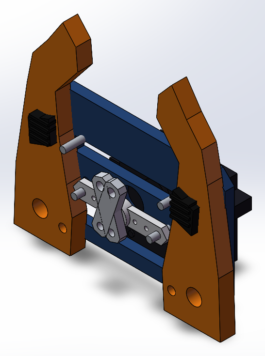

# Robot Arm — Camera Intrinsic & Eye-in-Hand Calibration

Course project for **SI190C Practical Robotics** (ShanghaiTech, Spring 2026).
A ROS 2 toolchain that calibrates a fisheye camera mounted on a robot wrist and solves the
camera-to-end-effector transform, plus a parametric gripper designed through the SolidWorks COM API.

> **Scope, stated up front.** The arm developed a joint-gear failure partway through the term and was
> not available for physical execution. The calibration numbers below are therefore **numeric /
> simulation consistency results**, not measured physical accuracy — the report keeps those two
> categories explicitly separate. See [Honest scope](#honest-scope).

---

## The problem

An eye-in-hand camera sees a marker fixed in the workspace. To use that observation for manipulation,
you need the rigid transform from the **camera frame** to the **end-effector frame**, `T_ec`:

```
T_bo  =  T_be · T_ec · T_cm
         │      │      └─ marker pose in camera frame   (ArUco + solvePnP)
         │      └──────── unknown, 6-DOF
         └─────────────── end-effector pose in base frame (forward kinematics)
```

`T_bo` is constant because the marker never moves, so relative motions turn this into the classic
hand-eye problem `A X = X B`, solved here with Tsai's method.

## The four steps

### 1 · Fisheye intrinsics

The supplied camera is a **fisheye with an equidistant projection, `r = f·θ`** — *not* a rectilinear
pinhole `r = f·tan θ`. That distinction matters: `cv2.calibrateCamera()` produces a wrong model for
this lens and quietly poisons everything downstream. The correct call is `cv2.fisheye.calibrate()`.

- 9 × 6 inner-corner checkerboard, 25 mm squares, sub-pixel corner refinement
- Result: `K`, four distortion coefficients `D`, and a reprojection RMS

| item | value |
|---|---|
| image size | 640 × 480 |
| reprojection RMS | **0.7553 px** (acceptance < 0.8 px) |
| fx, fy | 354.569, 351.722 |
| cx, cy | 281.249, 200.014 |
| D | 0.17083, −0.04136, 0.08014, −0.06016 |

Passing, but not excellent (0.5 px would be). More views near the image boundary and better focus are
the obvious next steps.

### 2 · Marker pose

ArUco `DICT_4X4_50`, 50 mm edge length, mounted flat and stationary. `solvePnP` against the calibrated
intrinsics gives one `T_cm` per frame. `aruco_tuner.py` exists because threshold and corner-quality
settings had to be re-tuned per lighting condition.

### 3 · Data collection

Move the arm through ≥ 10 poses with meaningful excitation — translation > 10 cm, rotation > 30° —
recording FK pose and vision pose together.

| item | value |
|---|---|
| recorded pairs | 12 |
| unique pose pairs | 10 (two duplicates) |
| end-effector X range | −0.279 … 0.167 m |
| end-effector Y range | −0.295 … 0.327 m |
| end-effector Z range | 0.021 … 0.468 m |

### 4 · Solve and verify

`cv2.calibrateHandEye(..., CALIB_HAND_EYE_TSAI)` on the relative-motion pairs.

Resulting `T_ec` is essentially a 180° rotation about Z plus a translation:

```
       ⎡ −1.000000   −0.000093   0.000000   0.000 ⎤
T_ec = ⎢  0.000093   −1.000000   0.000000   0.406 ⎥
       ⎢  0.000000    0.000000   1.000000   0.390 ⎥
       ⎣  0          0          0          1     ⎦
```

**How it was verified:** back-substitute every observation into `T_bo`. Because the marker is physically
fixed, all 10 poses must agree on one point in the base frame.

- recovered marker position: `[0.400, 0.000, 0.250] m`
- position spread across poses: **< 2.5e-10 mm**
- orientation spread: **< 1.3e-6°**

That residual proves **algebraic consistency of the transform chain**. It does not prove physical
accuracy — see below.

---

## Repository layout

```
code/
  camera_calibration.py   fisheye intrinsics from checkerboard images
  data_collector.py       subscribe camera, detect marker, pair with FK poses
  handeye_solver.py       build A/B motion pairs, cv2.calibrateHandEye (Tsai)
  verifier.py             independent-pose back-substitution check
  calibrate.py            run all four steps in sequence
  utils.py                transform / quaternion / rotation-vector helpers
  unified_gui.py          single-window GUI for the whole pipeline
  aruco_tuner.py          marker detection parameter tuning
  aruco_detect.py         standalone marker detection
  dict_finder.py          ArUco dictionary selection helper
  calibrate_from_video.py record a video, calibrate offline
  joint_control.py        joint-space motion helpers for data collection
  sim_data_collector.py   synthetic pose pairs (used when the arm was unavailable)
  sim_dict_finder.py      synthetic counterpart of dict_finder
  lab8_ik_solution.py     inverse kinematics (earlier lab, same arm)
  build_gripper_v2.py     parametric gripper modelling via SolidWorks COM API

data/       small calibration artifacts (intrinsics, pose pairs, solved transform)
figures/    trajectory plot and gripper render
gripper/    gripper design notes
report/     full course report (PDF)
```

## Dependencies

- ROS 2 Jazzy, `usb_cam`, and the course-provided arm packages
  (`joint_comm_node`, `joint_kinematics_node`) — **not included here**, they belong to the course
  repository.
- Python: `opencv-contrib-python` (needs `cv2.aruco`), `numpy`, `scipy`
- Optional: SolidWorks 2023–2025 + `pywin32`, Windows only, for `build_gripper_v2.py`

Camera topic in the course setup: `/camera1/image_raw`.

---

## Honest scope

Three things a reader should know before trusting any number above:

1. **The arm was unavailable for physical execution.** After a joint-gear failure, no executed
   `fk_poses.csv`, no ROS 2 bag, and no ArUco-measured trajectory exist. Physical MAE, RMSE,
   repeatability, velocity and acceleration **cannot be reported**.
2. **The hand-eye result matches hard-coded simulator values** to floating-point precision. The
   machine-precision residual is therefore a *simulation consistency check*, not independent evidence
   of robot accuracy.
3. **Raw checkerboard images and the original-vs-undistorted pair were not retained**, so view
   diversity and undistortion quality cannot be re-checked from this repository alone.

The report treats numerical verification and physical verification as separate claims throughout. That
separation is the honest part of this project.

---

## Gripper design

A two-finger parallel gripper driven by an MG996R-size servo, generated **programmatically** —
`build_gripper_v2.py` drives SolidWorks through its COM API rather than modelling by hand.

| item | value |
|---|---|
| mechanism | servo → double-arm horn → independent links → two pivoting hook jaws |
| frame | 100 × 65 × 5 mm |
| jaws | 8 mm thick, replaceable ribbed grip pads |
| pivots / links | Ø8 mm pivot pins, Ø3.3 mm link pins |
| tip opening | ≈ 36 mm (nominal open position) |
| assembly envelope | ≈ 100 × 143 × 38 mm |
| output | 11 parts + assembly, exported to STL / STEP |

Design notes: [`gripper/design_notes.md`](gripper/design_notes.md).



---

## What this project is *not*

This repository does **not** contain the course's own robot packages, the SolidWorks MCP server found
in my working directory (a third-party MIT project I used as a reference, not something I wrote), or
any hardware photographs. What is here is my own calibration code, my own CAD automation script, and
the results they produced.
